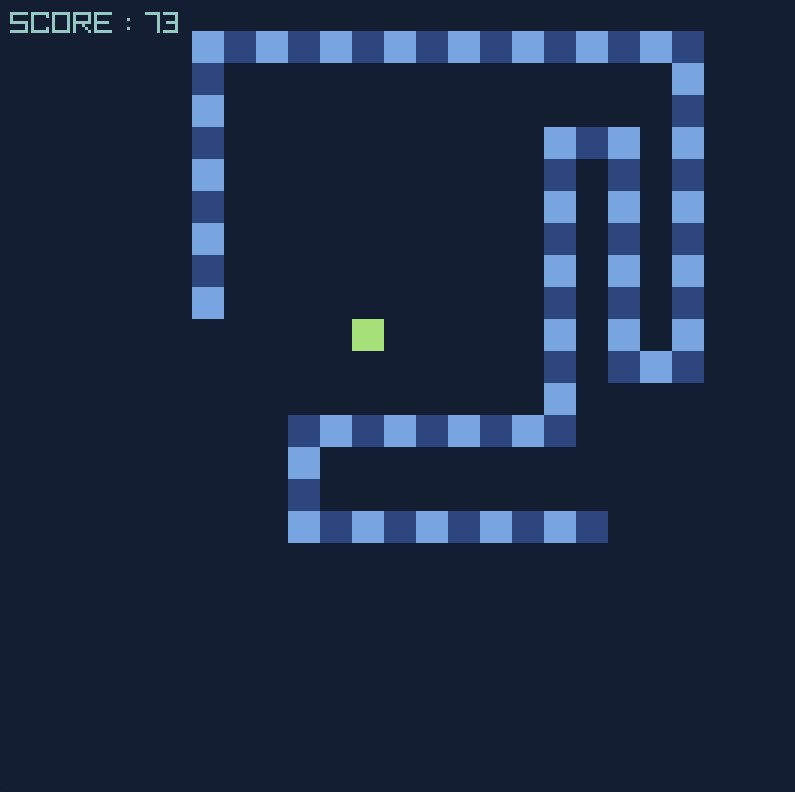

# Snake

This is just a little snake clone written in C using [raylib](https://raylib.com).



## How to build

For building this game, you need a C compiler like `gcc` of `clang` and the raylib library (get from [raylib.com](raylib.com) or build from [source](https://github.com/raysan5/raylib))

I use `make` to build it but `cmake` or any other unorthodox method under the sun to compile and link the libs with `main.c` should work.

If using `make`, the included `Makefile` should be enough.

Simply run
```
make
```

You can execute the game by `.\snake.exe` or `./snake`

Or you can add the extra arguement for speed like `.\snake.exe 20` to change the speed of the snake (default speed is 10).
